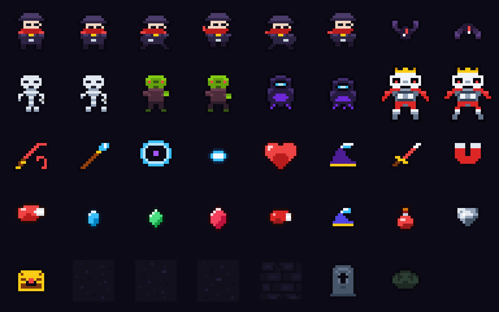

# Super Survivors

Game **survivor-like** bergaya *Dark Fantasy / Gothic* pixelated yang dibangun menggunakan **HTML5 Canvas**, **TypeScript**, dan **Vite** tanpa aset gambar atau audio eksternal (seluruh sprite dan efek suara *chiptune* dibuat secara prosedural).

---

## Preview Model Pixel-Art



> Seluruh aset PNG (karakter, musuh, senjata, pasif, item drop, dan tile lingkungan) tersedia di folder [`assets/`](assets/).

---

## Fitur Utama

- **Grafis Pixel-Art Tajam (`480×270`)**: Dirender dengan `imageSmoothingEnabled = false` dan `image-rendering: pixelated`, lengkap dengan latar kuburan gothic *infinite tiling*, batu nisan prosedural, serta animasi karakter utama *Pemburu Malam* (4-frame jalan + 2-frame *idle*).
- **3 Senjata Otomatis (Lv 1–5)**:
  - **Cambuk Darah (`whip`)**: Membidik otomatis musuh terdekat 360° dengan tebasan lentur dan *knockback* kuat (2 arah bersamaan mulai Lv 3).
  - **Tongkat Sihir (`wand`)**: Menembakkan rentetan baut sihir pelacak dengan kemampuan menembus musuh (*pierce*).
  - **Aura Jiwa (`aura`)**: Memancarkan cincin rune suci di sekitar karakter yang melukai dan mendorong mundur kepungan musuh.
- **5 Peningkatan Pasif**: *Vitalitas* (+Max HP), *Sepatu Bayangan* (+Speed), *Kekuatan Gelap* (+Damage), *Magnet Jiwa* (+Radius XP), dan *Daging Panggang* (Pulih HP).
- **Musuh, Varian Enhanced & Boss**:
  - 4 musuh reguler (*Bat*, *Skeleton*, *Zombie*, *Wraith*) serta Boss **Raja Tengkorak** yang muncul setiap 2 menit (`02:00`, `04:00`, dst.).
  - **Varian Enhanced**: Mulai detik ke-18, musuh biasa berpeluang muncul dalam wujud Enhanced beraura emas-merah dengan **3× HP**, **3× Damage**, dan menjatuhkan **Red Gem (3× XP)** serta peluang drop item tinggi.
- **Drop Item Acak & Chest**:
  - **Daging Panggang**: Pulihkan `+30 HP`.
  - **Swift Boots**: `+45%` kecepatan gerak selama `8` detik.
  - **Red Potion**: `+50%` damage seluruh senjata selama `10` detik.
  - **Iron Shield**: Kebal terhadap semua damage selama `3` detik.
  - **Chest**: Membuka 3 pilihan peningkatan `+1 level` untuk senjata atau pasif aktif.
- **UI & Audio Retro**: Main Menu multi-halaman (*Beranda*, *Senjata & Pasif*, *Entitas Musuh*), HUD dengan bar XP & indikator buff aktif, Menu Jeda dengan status lengkap & konfirmasi peringatan, serta efek suara retro berbasis Web Audio API.

---

## Kontrol

| Tombol | Aksi |
| --- | --- |
| `WASD` / `Panah` | Gerakkan karakter (senjata menyerang otomatis) |
| `1` `2` `3` atau Klik | Pilih kartu peningkatan saat Naik Level / membuka Chest |
| `ESC` / `P` | Jeda permainan & lihat status lengkap |
| `M` | Bisu / aktifkan suara SFX |
| `Enter` / `Space` | Mulai permainan (dari Beranda / layar Gugur) |

---

## Cara Menjalankan Lokal

Pastikan **Node.js** dan **npm** sudah terpasang, lalu jalankan di folder proyek:

```bash
# 1. Pasang dependensi
npm install

# 2. Jalankan development server
npm run dev
```

Buka URL `localhost` yang ditampilkan oleh Vite di browser.

### Perintah Lainnya

```bash
# Pemeriksaan tipe TypeScript
npm run typecheck

# Build produksi ke folder dist/
npm run build

# Pratinjau hasil build produksi
npm run preview
```

---

## Struktur Proyek

```text
├── index.html             # Struktur Canvas, HUD, Main Menu, dan Modal
├── package.json           # Konfigurasi proyek & skrip Vite/TypeScript
├── tsconfig.json          # Konfigurasi TypeScript (strict mode)
├── assets/                # Ekspor PNG model karakter, musuh, senjata, item, & tile
└── src/
    ├── main.ts            # Entry point & pengikatan Game + GameUI
    ├── style.css          # Tema gothic pixel UI & tata letak 16:9
    ├── types.ts           # Definisi interface & tipe inti game
    ├── sprites.ts         # Engine sprite pixel-art prosedural (offscreen canvas)
    ├── audio.ts           # Synthesizer efek suara retro Web Audio API
    ├── weapons.ts         # Data senjata, pasif, item drop, & roll upgrade/chest
    ├── spawner.ts         # Pengatur gelombang musuh, Enhanced, & Boss
    ├── game.ts            # Game loop, fisika, AI, combat, & renderer Canvas
    └── ui.ts              # Pengelola HUD, Main Menu multi-halaman, & modal
```
